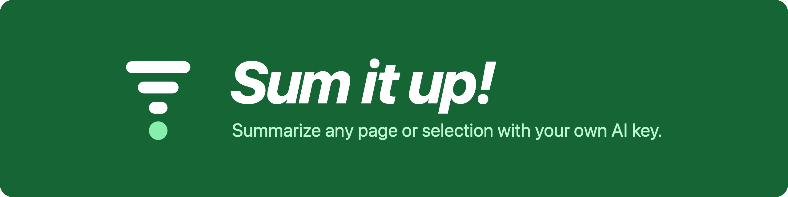
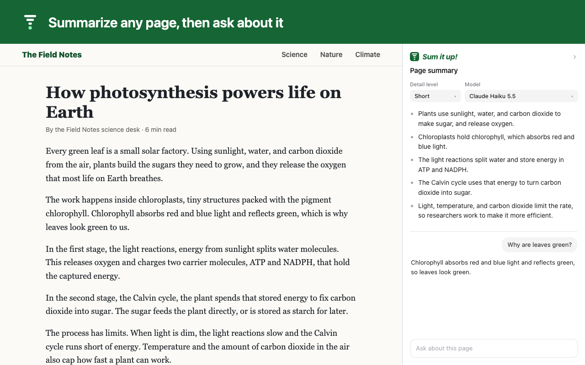
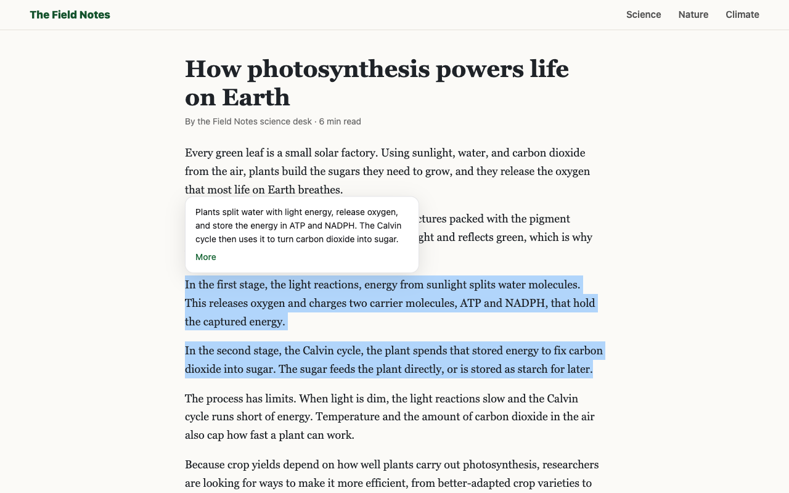
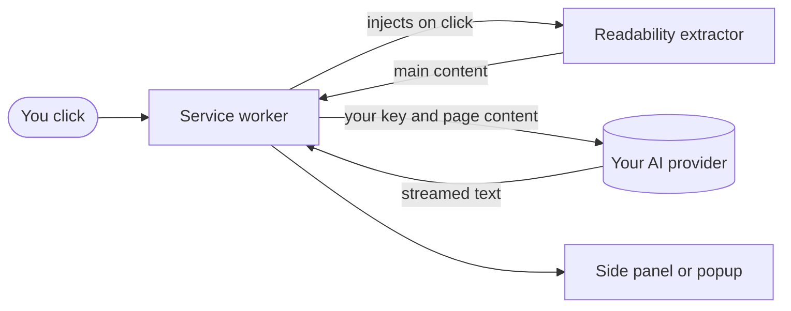

<p align="center">
  
</p>

<p align="center">
  <a href="https://chromewebstore.google.com/detail/sum-it-up/fpmekjhbnbhmefammcjlmmjodmnkpbmp"></a>
  <a href="https://github.com/mAzurkovic/sumitup/actions/workflows/ci.yml"></a>
  <a href="package.json"></a>
  <a href="LICENSE"></a>
  <a href="vitest.config.ts"></a>
  
</p>

<p align="center">
  <a href="#features">Features</a> ·
  <a href="#getting-started">Getting started</a> ·
  <a href="#privacy-and-security">Privacy</a> ·
  <a href="#roadmap">Roadmap</a> ·
  <a href="#contributing">Contributing</a>
</p>

**Sum it up!** is a Chrome extension that summarizes web pages and highlighted text in a side panel, then lets you ask follow-up questions about them. You bring your own Anthropic API key. There is no account, no subscription, and no server between you and the provider.

## Why

Long pages take a long time to read, and the more concepts they pack in, the harder they are to follow. Sum it up! gives you the short version beside the original page, at the depth you choose, and answers questions from that page's content.

## Features

- **Page summaries:** click the toolbar icon to summarize the page's main content. Navigation, ads, and comments are left out.
- **Highlight summaries:** select 20 or more words to get a "Sum it up!" button and a popup summary of at most 3 sentences. **More** opens the panel with a full summary of the selection and chat about it.
- **Four detail levels:** see the [table below](#detail-levels).
- **Grounded chat:** ask follow-up questions. Answers come only from the summarized content. If the page doesn't cover it, the reply says so instead of guessing.
- **Streaming with a Stop button:** text appears as it generates, and stopping keeps what you already have.
- **Cached summaries:** switching back to a level or model you already used, reloading the page, or reopening the panel shows the saved summary with no new request, until the tab closes.
- **Model switch:** pick another model from the menu, then summarize again with it. The summary on screen stays until the new one arrives.
- **Clear failures:** rate limits, a rejected key, a retired model, and lost connections each show their own message, with Retry or a link to the menu. Nothing retries on its own.
- **Very long pages:** you confirm an estimated token count first, then the page is split, summarized in parts, and merged.
- **No surprise spending:** nothing is sent to a provider until you click.
- **Light and dark themes:** follows your system setting.

### Detail levels

| Level | Output | Word limit |
|---|---|---|
| Short (default) | 3 to 5 bullets | 100 |
| Medium | Key points under headings | 300 |
| In-depth | Section-by-section summary with key concepts explained | 800 |
| ELI5 | Everyday words with at least one everyday analogy | 150 |

## Preview

| Page summary and chat | Highlight popup |
|---|---|
|  |  |

## Supported models

| Provider | Default (cheapest) | Balanced | Most capable | Status |
|---|---|---|---|---|
| Anthropic | `claude-haiku-5-5` | `claude-sonnet-5-5` | `claude-opus-5-5` | First release |
| OpenAI | `gpt-6-luna` | `gpt-6.1-sol` | `gpt-6-astra` | Planned |
| Google Gemini | `gemini-3.5-flash-lite` | `gemini-3.8-flash` | `gemini-4-argon` | Planned |

The default is the cheapest model, to protect your token budget. Provider usage is billed to your own key.

## How it works



All provider calls and key access stay in the service worker. Content scripts run on untrusted pages, so they never receive your key. Readability loads only when you click, which keeps page load fast.

See [requirements.md](specs/sum-it-up/requirements.md) and [design.md](specs/sum-it-up/design.md) for the full specification.

## Privacy and security

Provider calls go straight from your browser to the provider, with no backend in this repo. The full [privacy policy](store/privacy-policy.md) is in `store/`.

- **No developer server:** page content and keys go only from your browser to the provider you selected, and only when you click.
- **No tracking:** no analytics or telemetry, and no account.
- **Local keys:** your key lives in Chrome's local extension storage on your device, where page scripts and content scripts cannot read it. It does not sync across devices or profiles, and Chrome does not encrypt this storage on disk. Delete it from the panel's model menu at any time.
- **Temporary sessions:** each tab's summaries, chat, and page text stay in Chrome's session storage until the tab closes or Chrome quits.
- **Page text is data:** content is wrapped in delimiters so that instructions embedded in a page are not followed. Model output renders as plain formatted text, with no scripts, links, or remote content.

### Permissions

| Permission | Why it is needed |
|---|---|
| `sidePanel` | Shows the summary and chat panel |
| `storage` | Saves your key, model, and detail level, and holds session data |
| `scripting` | Injects the content extractor when you click |
| `<all_urls>` | Reads pages and shows the highlight button on any site |

`<all_urls>` makes Chrome show a "read and change all your data" warning at install. The highlight button needs it to work on all sites.

## Limitations

- Chrome only, version 141 or newer.
- Chrome blocks extensions on pages such as `chrome://`, the Chrome Web Store, and the new tab page, so they can't be summarized. PDFs aren't supported either.
- Pages under 200 words are not summarized.
- Video is not summarized. Pages with video use page text only, including YouTube until transcript support ships.
- The UI is in English only. Summaries use the language of the content, and chat answers use the language of your question.

## Getting started

You need Chrome 141 or newer and an API key from the [Anthropic Console](https://console.anthropic.com/settings/keys). Anthropic bills your key directly for what you use.

### Install

Install **Sum it up!** from the [Chrome Web Store](https://chromewebstore.google.com/detail/sum-it-up/fpmekjhbnbhmefammcjlmmjodmnkpbmp).

To install a release without the store, use the zip from the [latest release](https://github.com/mAzurkovic/sumitup/releases/latest):

1. Download `sum-it-up-<version>-chrome.zip` and unzip it.
2. Open `chrome://extensions` and turn on **Developer mode**.
3. Click **Load unpacked** and select the unzipped folder.

### Use

1. Click the **Sum it up!** toolbar icon. The side panel opens and asks for your key.
2. Paste your key and click **Save**. The summary starts.
3. Change the detail level or model at the top of the panel, or ask a question in the chat box.
4. On any page, select 20 or more words and click the **Sum it up!** button for a quick summary.

### Build from source

You need [Node.js](https://nodejs.org/) 24, the version CI uses.

```sh
git clone https://github.com/mAzurkovic/sumitup.git
cd sumitup
npm ci
npm run build
```

Then load `dist/chrome-mv3` with **Load unpacked**, as above.

## Development

| Command | What it does |
|---|---|
| `npm run dev` | Starts WXT in development mode with reload |
| `npm run build` | Builds the production extension to `dist/chrome-mv3` |
| `npm run zip` | Packages the extension as a zip |
| `npm run typecheck` | Runs the TypeScript check |
| `npm test` | Runs the Vitest suite. No API key is needed |
| `npm run coverage` | Runs tests and enforces 100% line, branch, and statement coverage |
| `npm run e2e` | Builds a test version and runs the Playwright tests in headless Chromium against a local fake provider. No API key is needed |

`scripts/build-icons` regenerates the toolbar icons from `src/assets/logo.svg`. It needs `librsvg`.

The end-to-end tests build with `wxt build --mode test`, which reads `.env.test` and points the extension at the fake provider on `127.0.0.1:4319`. A test checks that the production build calls only `api.anthropic.com`. The fake provider uses a fixed port, so run one end-to-end run at a time.

### Releases

1. Set the new version in `package.json` and merge it.
2. Push a tag that matches it, such as `v1.0.0`. A suffix, such as `v1.1.0-rc1`, makes a pre-release.
3. The release workflow runs all CI checks, then attaches `sum-it-up-<version>-chrome.zip` to a GitHub Release.
4. Upload the zip in the Chrome Web Store developer dashboard. The listing text, privacy answers, and images are in `store/`.

### Project layout

```text
src/
  entrypoints/
    background.ts   Service worker
    content/        On-page selection UI
    sidepanel/      Side panel
    extract.ts      Main content extractor, injected on click
  lib/
    providers/      Provider adapters and stream parsing
    chat.ts         Grounded chat
    models.ts       Fixed model list and limits
    prompts.ts      System prompts
    session.ts      Per-tab session state and summary cache
    summarize.ts    Single-call and split-and-merge flows
    text.ts         Word count, token estimate, part matching
specs/sum-it-up/    Requirements, design, tasks, proofs, and UI mocks
store/              Chrome Web Store listing, privacy answers, privacy policy, and images
tests/              Vitest tests and the fake provider
  e2e/              Playwright tests
```

Built with [WXT](https://wxt.dev/) and TypeScript. Provider calls use plain `fetch` with no AI SDK, so every network call is easy to audit.

## Roadmap

Detailed status is in [tasks.md](specs/sum-it-up/tasks.md).

- [x] Extension scaffold, CI, and technical proofs
- [x] Claude provider, model list, text tools, and prompts
- [x] Content extraction, session store, summarizer, and chat logic
- [x] Service worker: keys, settings, ports, toolbar, and navigation
- [x] Highlight button and popup
- [x] Side panel UI
- [x] End-to-end tests against a fake provider, in CI
- [x] Release workflow and store listing
- [x] First release on the Chrome Web Store
- [ ] Quality evals against real models
- [ ] OpenAI and Google Gemini providers
- [ ] YouTube summaries from transcripts

## Contributing

Issues and pull requests are welcome. Before you open a pull request:

1. Read the [requirements](specs/sum-it-up/requirements.md) and [design](specs/sum-it-up/design.md), because behavior changes should match them or update them.
2. Add tests with your change.
3. Run the same checks as CI:

```sh
npm run typecheck
npm run coverage
npm run build
npm run e2e
```

Never commit API keys. `.env.local` is ignored by git for this reason.

## License

[MIT](LICENSE) © 2026 Mattias Zurkovic

## Acknowledgements

- [Mozilla Readability](https://github.com/mozilla/readability) for main content extraction
- [WXT](https://wxt.dev/) for the extension framework
