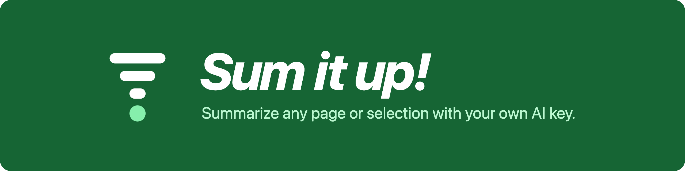
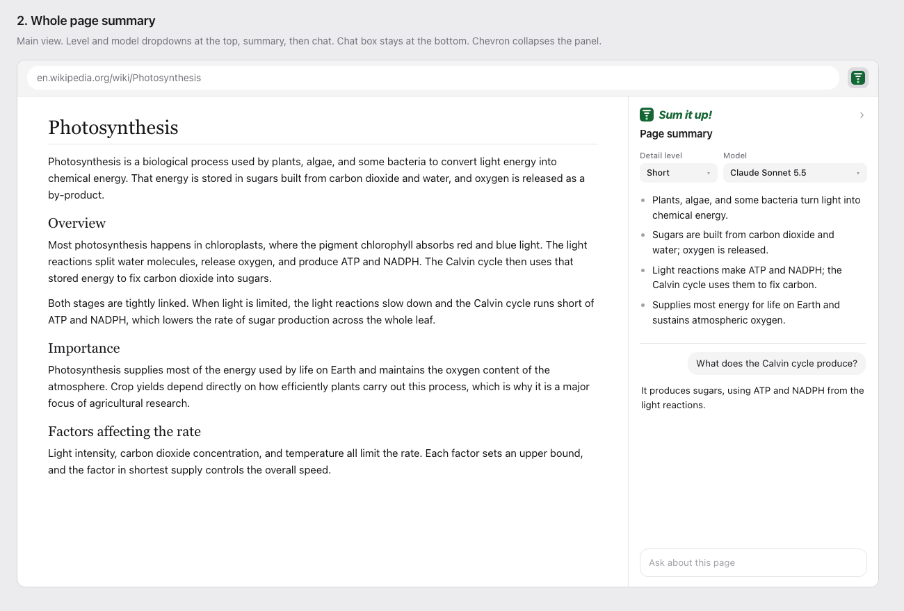
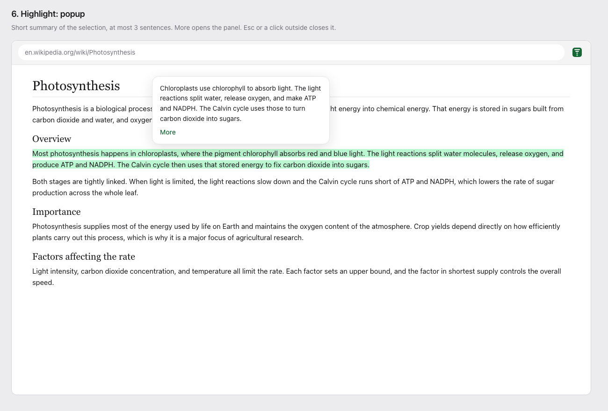
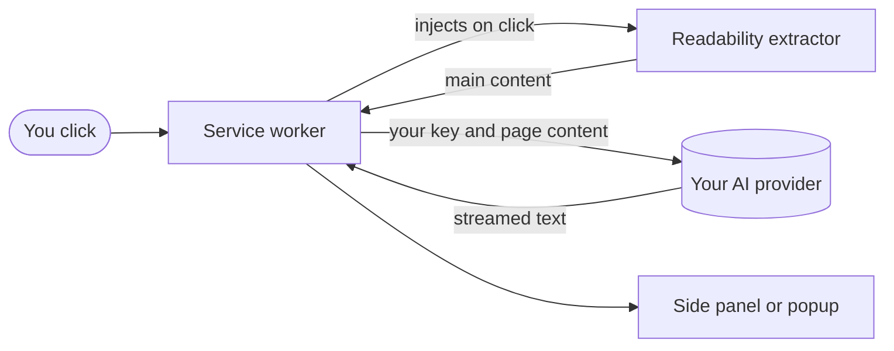

<p align="center">
  
</p>

<p align="center">
  <a href="https://github.com/mAzurkovic/sumitup/actions/workflows/ci.yml"></a>
  <a href="package.json"></a>
  <a href="LICENSE"></a>
  <a href="vitest.config.ts"></a>
  
</p>

<p align="center">
  <a href="#features">Features</a> ·
  <a href="#getting-started">Getting started</a> ·
  <a href="#privacy-and-security">Privacy</a> ·
  <a href="#roadmap">Roadmap</a> ·
  <a href="#contributing">Contributing</a>
</p>

**Sum it up!** is a Chrome extension that summarizes web pages and highlighted text in a side panel, then lets you ask follow-up questions about them. You bring your own AI key. There is no account, no subscription, and no server between you and the provider.

> [!IMPORTANT]
> **Not usable yet.** The core libraries are built and tested, but the side panel and on-page UI are not. If you load the extension today, you get a toolbar icon and nothing else. This README describes the planned first release. See the [roadmap](#roadmap) for what is done, and watch the repo for the first release.

## Why

Long pages take a long time to read, and the more concepts they pack in, the harder they are to follow. Sum it up! gives you the short version beside the original page, at the depth you choose, and answers questions from that page's content.

## Features

- **Page summaries:** click the toolbar icon to summarize the page's main content. Navigation, ads, footers, and comments are left out.
- **Highlight summaries:** select 20 or more words to get a "Sum it up!" button and a popup summary of at most 3 sentences.
- **Four detail levels:** see the [table below](#detail-levels).
- **Grounded chat:** ask follow-up questions. Answers come only from the summarized content. If the page doesn't cover it, the reply says so instead of guessing.
- **Streaming with a Stop button:** text appears as it generates, and stopping keeps what you already have.
- **Very long pages:** you confirm an estimated token count first, then the page is split, summarized in parts, and merged.
- **No surprise spending:** nothing is sent to a provider until you click.
- **Light and dark themes:** follows your system setting.

### Detail levels

| Level | Output | Word limit |
|---|---|---|
| Short (default) | 3 to 5 bullets | 100 |
| Medium | Key points under headings | 300 |
| In-depth | Section-by-section summary with key concepts explained | 800 |
| ELI5 | Everyday words with at least one everyday analogy | 150 |

## Preview

These are design mocks, not screenshots of a running build. The final UI may differ.

| Page summary and chat | Highlight popup |
|---|---|
|  |  |

## Supported models

| Provider | Default (cheapest) | Balanced | Most capable | Status |
|---|---|---|---|---|
| Anthropic | `claude-haiku-5-5` | `claude-sonnet-5-5` | `claude-opus-5-5` | First release |
| OpenAI | `gpt-6-luna` | `gpt-6.1-sol` | `gpt-6-astra` | Planned |
| Google Gemini | `gemini-3.5-flash-lite` | `gemini-3.8-flash` | `gemini-4-argon` | Planned |

The default is the cheapest model, to protect your token budget. Provider usage is billed to your own key.

## How it works



All provider calls and key access stay in the service worker. Content scripts run on untrusted pages, so they never receive your key. Readability loads only when you click, which keeps page load fast.

See [requirements.md](specs/sum-it-up/requirements.md) and [design.md](specs/sum-it-up/design.md) for the full specification.

## Privacy and security

These are design requirements for the first release. Provider calls are direct, with no backend in this repo.

- **No developer server:** page content and keys go only from your browser to the provider you selected.
- **No tracking:** no analytics or telemetry, and no account.
- **Local keys:** keys live in Chrome's local extension storage on your device. They do not sync across devices or profiles, and Chrome does not encrypt this storage on disk.
- **Temporary sessions:** summaries and chat stay in memory only and clear when the browser restarts.
- **Page text is data:** content is wrapped in delimiters so that instructions embedded in a page are not followed. Model output renders as plain formatted text, with no scripts and no auto-loaded remote content.

### Permissions

| Permission | Why it is needed |
|---|---|
| `sidePanel` | Shows the summary and chat panel |
| `storage` | Saves your key, model, and detail level, and holds session data |
| `scripting` | Injects the content extractor when you click |
| `<all_urls>` | Reads pages and shows the highlight button on any site |

`<all_urls>` makes Chrome show a "read and change all your data" warning at install. The highlight button needs it to work on all sites.

## Limitations

- Chrome only, version 141 or newer.
- Chrome blocks extensions on pages such as `chrome://`, the Chrome Web Store, and the new tab page, so they can't be summarized. PDFs aren't supported either.
- Pages under 200 words are not summarized.
- Video is not summarized. Pages with video use page text only, including YouTube until transcript support ships.
- The UI is in English only. Summaries use the language of the content, and chat answers use the language of your question.

## Getting started

The extension is not on the Chrome Web Store yet. To build it from source, you need [Node.js](https://nodejs.org/) 24 (the version CI uses) and Chrome 141 or newer.

```sh
git clone https://github.com/mAzurkovic/sumitup.git
cd sumitup
npm ci
npm run build
```

Then load it in Chrome:

1. Open `chrome://extensions`.
2. Turn on **Developer mode**.
3. Click **Load unpacked** and select `dist/chrome-mv3`.

When the UI ships, you will also need an API key from your provider, such as the [Anthropic Console](https://console.anthropic.com/).

## Development

| Command | What it does |
|---|---|
| `npm run dev` | Starts WXT in development mode with reload |
| `npm run build` | Builds the production extension to `dist/chrome-mv3` |
| `npm run zip` | Packages the extension as a zip |
| `npm run typecheck` | Runs the TypeScript check |
| `npm test` | Runs the Vitest suite. No API key is needed |
| `npm run coverage` | Runs tests and enforces 100% line, branch, and statement coverage |

`scripts/build-icons` regenerates the toolbar icons from `src/assets/logo.svg`. It needs `librsvg`.

### Project layout

```text
src/
  entrypoints/
    background.ts   Service worker
    content/        On-page selection UI
    sidepanel/      Side panel
    extract.ts      Main content extractor, injected on click
  lib/
    providers/      Provider adapters and stream parsing
    chat.ts         Grounded chat
    models.ts       Fixed model list and limits
    prompts.ts      System prompts
    session.ts      Per-tab session state and summary cache
    summarize.ts    Single-call and split-and-merge flows
    text.ts         Word count, token estimate, part matching
specs/sum-it-up/    Requirements, design, tasks, proofs, and UI mocks
tests/              Vitest tests
```

Built with [WXT](https://wxt.dev/) and TypeScript. Provider calls use plain `fetch` with no AI SDK, so every network call is easy to audit.

## Roadmap

Detailed status is in [tasks.md](specs/sum-it-up/tasks.md).

- [x] Extension scaffold, CI, and technical proofs
- [x] Claude provider, model list, text tools, and prompts
- [x] Content extraction, session store, summarizer, and chat logic
- [ ] Service worker: keys, settings, ports, toolbar, and navigation
- [ ] Highlight button and popup
- [ ] Side panel UI
- [ ] End-to-end tests and quality evals
- [ ] First release on the Chrome Web Store
- [ ] OpenAI and Google Gemini providers
- [ ] YouTube summaries from transcripts

## Contributing

Issues and pull requests are welcome. Before you open a pull request:

1. Read the [requirements](specs/sum-it-up/requirements.md) and [design](specs/sum-it-up/design.md), because behavior changes should match them or update them.
2. Add tests with your change.
3. Run the same checks as CI:

```sh
npm run typecheck
npm run coverage
npm run build
```

Never commit API keys. `.env.local` is ignored by git for this reason.

## License

[MIT](LICENSE) © 2026 Mattias Zurkovic

## Acknowledgements

- [Mozilla Readability](https://github.com/mozilla/readability) for main content extraction
- [WXT](https://wxt.dev/) for the extension framework
