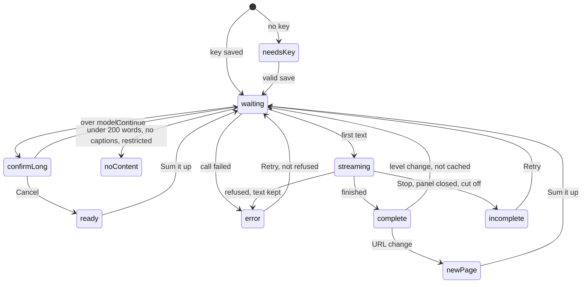
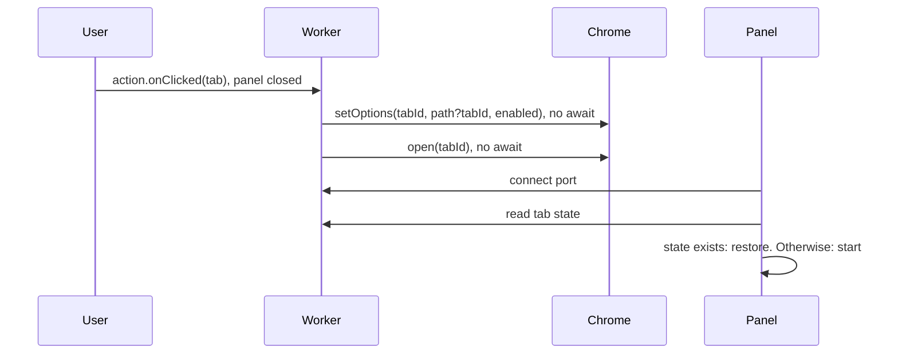

# Sum it up! Design

Inputs: [requirements.md](requirements.md), [mocks/](mocks/index.html).

## Overview

- Chrome extension that summarizes pages, selected text, and later YouTube transcripts (P1) in a side panel or on-page popup, with chat grounded in that content.
- Manifest V3, minimum Chrome 141. No backend (NFR8): the service worker holds the key and calls the Anthropic API directly with the user's key. OpenAI and Google are P1, and their rows below stay as the plan for that work.

## Stack

- WXT 0.21.5, pinned exact. TypeScript. npm.
- React 19, side panel only. Plain CSS with shared variables, styled per Visual Style below. No UI library.
- Plain TypeScript for on-page UI.
- `@mozilla/readability` 0.6.0, loaded on click only.
- Build output in `dist/`, visible in Finder.
- Vitest 5, `@playwright/test` 1.64.
- No AI SDK, no Markdown library.

## Components

Paths under `src/`.

| Component | Location | Responsibility |
|---|---|---|
| Service worker | `entrypoints/background.ts` | Toolbar clicks, tab tracking, ports, all provider calls, key access |
| Selection UI | `entrypoints/content/` | Button and popup in a closed Shadow DOM, top frame only, no framework (mocks 05, 06) |
| Side panel | `entrypoints/sidepanel/` | React app, one instance per tab (mocks 01 to 04, 07 to 09) |
| Extractor | `entrypoints/extract.ts` | Unlisted script injected on click. Readability on a cloned document, word count, video flag. Removes navigation, ads, and comments first by exact markers only: `<nav>`, known ad classes and ad networks, and a clearly titled last section. Deleting real content is worse than keeping a stray ad, so other names are not chased. Misses are measured by the NFR5 eval |
| YouTube reader (P1) | `lib/youtube.ts` | Transcript panel read. All YouTube selectors live here |
| Provider adapter | `lib/providers/anthropic.ts`, with `openai.ts` and `gemini.ts` in P1 | One fetch and stream parser per provider |
| Model registry | `lib/models.ts` | Fixed model list, defaults, input limits, per-model request settings |
| Summarizer | `lib/summarize.ts` | Single-call and split-and-merge flows |
| Chat | `lib/chat.ts` | Grounded prompt, part matching, history trimming |
| Prompts | `lib/prompts.ts` | System prompt per level and for chat. Wraps content in delimiters (NFR12) |
| Text tools | `lib/text.ts` | Word count (`Intl.Segmenter`), token estimate, paragraph split, keyword match |
| Output renderer | `entrypoints/sidepanel/Markdown.tsx` | Bullets, headings, bold to React elements. No raw HTML, images, or live links (NFR13) |
| Session store | `lib/session.ts` | Tab state in `storage.session`, eviction |

### Panel UI

| Component | Mock | Notes |
|---|---|---|
| `Header` | 02 | "Sum it up!" wordmark and chevron, then heading ("Page summary" or "Selected text summary"). Fixed (FR73) |
| `LevelSelect` | 03, 04 | "Detail level" label above. Short, Medium, In-depth, ELI5. Fixed (FR73) |
| `ModelMenu` | 04 | "Model" label above. Pill shows model. Holds model, masked key, Delete, notice, and the provider choice in P1. All setup lives here (FR4, NFR15) |
| `KeySetup` | 01, 04 | Key field, key page link, notice, Save. Full panel on first use, inside `ModelMenu` otherwise |
| `ScopeLink` | 07 | "Summarize whole page". Fixed |
| `ModelSwitchAction` | 08 | "Summarize with <model>" (FR17). Fixed |
| `ScrollColumn` | 09 | Single scroll area for summary, divider, and messages (FR72). Scrolls to newest message (FR74) |
| `SummaryCard` | 02, 03, 08 | Streaming text, Stop, "Incomplete" tag, Retry, "Video not included" tag |
| `StatusCard` | 08 | Spinner, "New page", long page confirm, all FR46 messages |
| `ChatMessages` | 02, 09 | User and bot bubbles |
| `ChatInput` | all | Fixed at bottom in every state (FR62). Disabled until a complete or "Incomplete" summary is on screen, so not after a refusal (FR71) |

Panel state: `needsKey`, `newPage`, `ready`, `confirmLong`, `waiting`, `streaming`, `complete`, `incomplete`, `noContent`, `error`. Errors with a summary on screen show as a banner above it (FR47). A URL change from any state goes to `newPage` (FR58). `ready` shows "Sum it up?" with a button (FR29).

### Visual Style

Minimal and modern, per mock 10. `lib/theme.css` holds the variables, used by the panel and the popup.

- Theme: light and dark, follows the system with `prefers-color-scheme`. No theme setting.
- Color: neutral greys, one deep green accent for links, focus, and spinner. Primary buttons use the text color. Amber for "Incomplete" and "Video not included" tags only.

| Variable | Light | Dark |
|---|---|---|
| `--bg` | `#ffffff` | `#18181b` |
| `--text` | `#18181b` | `#f4f4f5` |
| `--muted` | `#71717a` | `#a1a1aa` |
| `--line` | `#e4e4e7` | `#2e2e33` |
| `--soft` | `#f4f4f5` | `#27272a` |
| `--accent` | `#166534` | `#86efac` |

- Wordmark: "Sum it up!" in weight 800 italic, tight letter spacing, accent color, no background, next to the logo. Shown in the panel header and setup. The highlight button uses the same lettering in white with the logo mark, on a `#166534` pill with a full radius. Button text stays regular.
- Logo: exclamation mark made of 3 shrinking white text lines and a `#86efac` dot, on a `#166534` rounded square, inline SVG in the panel, source at `assets/logo.svg`. Toolbar and store icons are PNGs generated from it at 16, 32, 48, and 128px.
- Type: system font stack, no web fonts (NFR10). Body 14px, line height 1.55. Headings 15px, weight 600.
- Layout: no box around the summary. Text sits directly on the panel. 16px panel padding. 1px `--line` divider under the summary whenever one is on screen, scrolling with the content.
- Controls: borderless pills on `--soft`, 8px radius, small label above each dropdown. Chat box 12px radius with a hairline border.
- Chat: user messages in a soft bubble, bot messages as plain text.
- Depth: shadows only on floating elements (dropdowns, popup, highlight button).
- Motion: 120ms fade on dropdowns and popup, a spinner, and streaming text. No other animation. Respects `prefers-reduced-motion`.
- Dropdowns: native `<select>` with `appearance: base-select` (Chrome 135+), so the open list is styled too. `ModelMenu` uses the Popover API.

## Manifest

- Permissions: `sidePanel`, `storage`, `scripting`.
- Host permissions: `<all_urls>`. Needed for FR38 on all sites. Shows Chrome's "read and change all your data" install warning and draws closer store review.
- Content script: `<all_urls>`, `document_idle`, `all_frames: false`.
- Panel disabled by default: `sidePanel.setOptions({enabled: false})` on every worker start, because Chrome resets it on browser restart. An `onStartup` listener is what makes Chrome start the worker on a browser start, so it stays even though the call also runs directly. Enabled per tab with `sidePanel.setOptions({tabId, path, enabled})`.
- No `externally_connectable`. No remote code.

## Data Model

- `storage.local`, restricted with `setAccessLevel(TRUSTED_CONTEXTS)` on install so content scripts have no access:
  - `keys`: `{anthropic?}` strings. P1 adds `openai` and `gemini`.
  - `settings`: `{provider, modelByProvider, level}`. `provider` is always `anthropic` until P1.
- `storage.session`, memory only, default restricted, cleared on browser restart (FR66):
  - `tab:<tabId>`: `{url, scope, selectionText?, summaries, chat[], source?}`.
  - `summaries`: map of `<url>|<scope>|<level>|<model>` to `{text, status: complete|incomplete|refused}` (FR56). `<url>` has no fragment, because a fragment change is not navigation (FR60). The worker removes it before it builds the key.
  - `chat[]`: `{role, text}`.
  - `source`: `{kind: page|transcript|selection, text, videoExcluded}`.
- A new selection deletes the tab's `selection` summaries, because the cache key does not identify the selected text.
- Limits: 10 MB session quota. Over quota: drop `source` text from the least recently used tab, keep summaries and chat, re-extract on next need at no token cost. Only a write counts as use, so a tab that was only read can lose its `source` first. A selection source comes back from `selectionText`, not from a page extract.
- Cleanup: `tabs.onRemoved` deletes the tab entry (FR56, FR65). Extension update clears session data. Accepted.

## Models

| Provider | Default (cheapest) | Balanced | Most capable |
|---|---|---|---|
| Anthropic | `claude-haiku-5-5` | `claude-sonnet-5-5` | `claude-opus-5-5` |
| OpenAI (P1) | `gpt-6-luna` | `gpt-6.1-sol` | `gpt-6-astra` |
| Google (P1) | `gemini-3.5-flash-lite` | `gemini-3.8-flash` | `gemini-4-argon` |

- Input limits stored in `lib/models.ts`. Anthropic 1M. In P1: OpenAI 1.05M, and Google 1,048,576 from its docs, checked against `inputTokenLimit`.
- P1 lowest settings, from the provider docs: OpenAI `reasoning.effort` is `none` on `gpt-6-luna` and `low` on the others. Google `thinkingLevel` is `MINIMAL` on `gemini-3.5-flash-lite` and `LOW` on the others. OpenAI requests set `store: false`, so the provider does not keep page content.
- Per-model settings stored there. All models use their lowest effort setting. Anthropic: `output_config: {effort: "low"}` with thinking left on. First text stayed under 4s on all runs across the 3 Anthropic models, and `between_tools` was slower.
- `maxOutput` is 4000 tokens at every level. Thinking counts toward it, and lower values stopped Haiku early in testing (300 stopped with no text, 500 stopped at 91 words). Word caps come from the prompts.
- Defaults are the cheapest model on each provider, chosen by the product owner to protect users' tokens. Summary quality on these is not yet judged.

## Interfaces

Provider adapter:

- `validateKey(key)` → `void`. Lists models, costs no tokens (FR11). Throws `ProviderError`.
- `stream({key, model, system, messages, maxOutput, signal})` → `AsyncIterable<string>`. Throws `ProviderError`.

| Provider | Stream call | Auth | Validate |
|---|---|---|---|
| Anthropic | `POST api.anthropic.com/v1/messages` | `x-api-key`, `anthropic-version`, `anthropic-dangerous-direct-browser-access: true` | `GET /v1/models` |
| OpenAI (P1) | `POST api.openai.com/v1/responses`, reads `response.output_text.delta` | `Authorization: Bearer` | `GET /v1/models` |
| Google (P1) | `POST generativelanguage.googleapis.com/v1beta/models/<id>:streamGenerateContent?alt=sse` | `x-goog-api-key` | `GET /v1beta/models` |

`ProviderError.kind`, mapped to FR46:

- `auth`: 401, 403, and in P1 Gemini 400 with `API_KEY_INVALID`.
- `rate`: 429, 402, Anthropic 400 with the credit balance message. Other providers' credit errors get added once proven with real keys.
- `unavailable`: 5xx, no first text within 30s, or fetch `TypeError` with `navigator.onLine` true (DNS failure, dropped VPN).
- `offline`: fetch `TypeError` with `navigator.onLine` false.
- `cutoff`: stream ended without the provider's finish event, an error event arrived inside a 200 stream (so a mid-stream rate limit shows as cut off), or the stream finished with no text or with any Anthropic `stop_reason` other than `end_turn`, `stop_sequence`, or `refusal` (such as `max_tokens` or `model_context_window_exceeded`). With no text yet, it shows "Provider unavailable" with Retry.
- The 30s limit applies to first text only. A stream that stalls after that has no time limit, and the user can press Stop.
- Once the response has started, a dropped connection or a malformed event is `cutoff`, even when offline. `offline` applies only to the fetch call itself.
- `modelGone`: 404 on the model.
- `rejected`: any other 4xx.
- `refused`: Anthropic `stop_reason: "refusal"` on HTTP 200, or the other providers' equivalent. With text on screen, it is stored as `refused` and shows the FR46 message and link, with no Retry, including after the panel reopens.

Anthropic stream: text in `content_block_delta` with `text_delta`, finish in `message_delta` with `stop_reason`, then `message_stop`, which the adapter does not wait for. A fallback continues on the same stream: text so far stays, a `fallback` block marks the switch, and text continues. Requests to `claude-sonnet-5-5` and `claude-opus-5-5` add `fallbacks: "default"` with `anthropic-beta: server-side-fallback-2026-07-01`, so some false refusals can still get a summary. The default `claude-haiku-5-5` has no server-side fallback, so its refusals show the FR46 message.

Runtime messages:

- Panel to worker: port `panel:<tabId>`. Sends `summarize`, `retry`, `stop`, `chat`, `setLevel`, `setModel`, `saveKey`, `deleteKey`. Receives `state`, `delta`, `done`, `error`, `navigated`.
- Content script to worker: port `selection`. Sends `summarizeSelection {text}`, `stop`. Receives `delta`, `done`, `error`. Message `openPanel {text}` for "More" and no key.
- Worker takes `tabId` from `sender.tab.id`, never from the message. Content script never receives keys.

## Flows

### Toolbar click (FR18, FR19, FR21)

`sidePanel.open` only works in the user action, so the worker calls it before any `await`.

- Panel open: Chrome closes it on a toolbar click, with no `action.onClicked` event. Seen from the extensions menu. A pinned icon is checked in the toolbar task.
- Open panels hold a port and reconnect when it drops, so a restarted worker sees them again.
- Chevron calls `sidePanel.close`. Other tabs stay disabled (FR23).

### Page summary

- 1. Panel sends `summarize`. Worker checks the key, then the cache by URL, scope, level, model.
- 2. Worker reads content: `scripting.executeScript` runs `extract.ts`. YouTube pages use this path until the P1 read ships. Injection failure or `contentType` PDF means restricted (FR33).
- 3. Under 200 words: `noContent`, no call (FR26). Over the model limit: `confirmLong` with token estimate (FR27).
- 4. Worker streams from the adapter, sends `delta` to the panel, saves text to session as it arrives.
- 5. Stop or port disconnect aborts the fetch. Text so far saved as `incomplete` (FR32, FR77). The library code passes the abort up as `AbortError`, and the worker turns that into `incomplete`, not an FR46 failure. No auto-retry anywhere (FR48).

### Long content (FR27, FR28)

- Estimate: characters / 2.5, the conservative ratio from Anthropic's docs. Used for all providers.
- Split on paragraph boundaries, each part at most 80% of the input limit.
- Summarize parts, 3 at a time, without streaming. Panel shows "Summarizing" (spinner).
- Merge part summaries in one final streamed call at the selected level.
- Any part failing fails the whole run, with the matching FR46 message.

### Chat (FR63, FR64, FR78)

- System prompt: answer only from delimited content, otherwise reply exactly "This page doesn't cover that".
- Under the limit: send full `source.text` each question.
- Over the limit: split into parts, score with keyword match, send top parts up to the limit. No match: return the fixed reply with no API call.
- Keywords are the question's words minus common English words. A question of only common words uses all its words, so a part that shares them still gets sent and costs a call. Other languages have no common word list yet.
- History trimmed oldest first to stay under the limit. Cleared on URL change and on scope change (FR45, FR58).

### Selection (FR38 to FR44)

- `mouseup` handler counts words only when a selection exists. Skips inputs and `isContentEditable` (FR40).
- Button click must have `event.isTrusted`, so a page script cannot trigger a paid call (NFR11).
- Popup renders with `textContent`, fixed position above the selection, below it when there is no room.
- "More" and no key: `openPanel` message, worker calls `setOptions` and `open` synchronously in the handler, panel starts with scope `selection`.

### Navigation (FR57 to FR61)

- `tabs.onUpdated` with `url`: compare with stored URL minus fragment. Different: clear summary and chat view, send `navigated` (mock 08). Fragment only: ignore.
- `status: loading` with the same URL: reload, delete that URL's summaries (FR57).
- Works for single-page apps, since `onUpdated` reports history changes.

### YouTube transcript, P1 (FR34, FR35, FR46 row)

Not in the first release. Proofs showed caption track fetches return empty today.

- 1. Watch page detected by URL. Worker runs a `MAIN` world script: read caption tracks from `#movie_player.getPlayerResponse()`, checking the video ID matches the URL. `ytInitialPlayerResponse` goes stale after in-page navigation.
- 2. Empty track list: "No transcript available for this video".
- 3. Tracks exist: click "Show transcript", wait up to 5s for segments, read text, close the panel.
- 4. Panel fails: "Couldn't read the transcript", Retry.

## Infra

- Repo: GitHub. No hosting, no server.
- `.github/workflows/ci.yml`, on pull request: `tsc`, Vitest, `wxt build`, Playwright against a local fake provider server. No keys, no tokens.
- `.github/workflows/release.yml`, on version tag: runs CI steps, `wxt zip`, attaches the zip to a GitHub Release. Upload to the store is manual.
- `npm run eval`, local with your keys, before each release: NFR1, NFR4, NFR5 report, NFR10 network log, NFR12, FR64, FR76. Runs on the default models at lowest effort to limit token use. All live test calls follow the same rule unless a test needs a specific model. Test pages in `evals/pages.json`.
- Test build sets provider base URLs through a build variable to reach the fake server. Production builds hardcode real hosts.
- Playwright: `launchPersistentContext` with `--load-extension`. Fake server scripts every FR46 failure.
- Store listing: privacy disclosure (NFR14) and privacy policy in `store/`.

## Key Decisions

- D1. All provider calls in the service worker. Alternative: panel calls for panel features. Why: popup also needs calls, and content scripts run on untrusted pages, so one keyed location is safest.
- D2. WXT pinned exact. Alternative: plain Vite. Why: saves manifest, reload, and packaging work, and only runs at build time. Risk: one main maintainer, pre-1.0.
- D3. Direct fetch adapters. Alternative: Vercel AI SDK. Why: auditable network calls (NFR10), raw status codes (FR46), no retry defaults to disable (FR48).
- D4. React in panel, plain TypeScript on pages. Alternative: React everywhere. Why: protects the 50ms limit in NFR3 on every site.
- D5. Plain CSS with a defined visual style, no UI library. Alternative: Tailwind or a component kit. Why: about a dozen components, the look comes from the variables and rules above, and native dropdowns plus the Popover API cover what a kit would add.
- D6. Readability injected on click. Alternative: bundle in the content script. Why: nothing heavy loads on page load.
- D7. Panel-only YouTube read, P1. Alternative: caption fetch first, or a paid API. Why: caption fetch returned empty on 6 of 6 runs, and paid APIs break NFR8. Limit: depends on YouTube's page layout.
- D8. Keyword match for long-page chat. Alternative: part summaries, embeddings. Why: uses real page text at no extra API cost. Limit: misses questions that share no words with the page.
- D9. Key check by listing models. Alternative: 1-token test call. Why: no token cost.
- D10. Abort on panel close (FR77). Alternative: keep generating. Why: no spending with nothing on screen, and the worker can be shut down mid-run.
- D11. Summaries streamed through `storage.session`. Alternative: IndexedDB. Why: memory only, so FR66 holds without extra cleanup.
- D13. Word caps set in the prompts and measured in the eval. Alternative: cut text after generation. Why: a basic prompt overshot the 100-word cap, and cutting text mid-sentence reads worse.
- D14. Server-side refusal fallback on Anthropic. Alternative: show the refusal only. Why: pages on security topics can trigger false refusals. Limit: Sonnet 5.5 retries only the `cyber` and `frontier_llm` categories, so other refusals still show the FR46 message. The fallback model runs at its own rates, and it is unproven until task 2.3. If that check rejects the request, remove `fallbacks` and this decision.
- D12. Manual store upload. Alternative: automated on tag. Why: no store credentials in CI, and a bad tag cannot reach review.

## Open Questions

Results in [proofs.md](proofs.md).

- OQ1. OpenAI and Gemini with real keys: streaming, finish events, credit errors, refusals, output limit stops, input limits, first text time. Moved to P1 by the product owner, and it blocks shipping those providers, not the first release.
