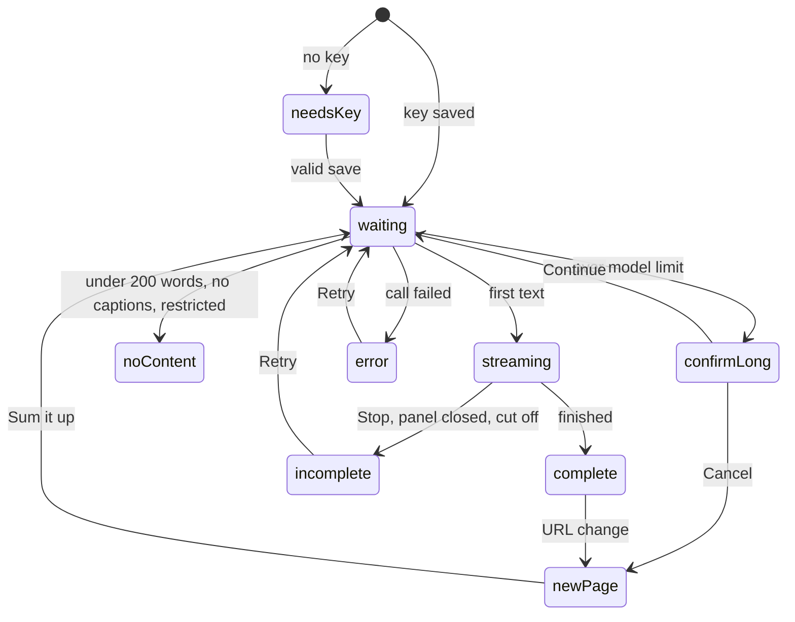
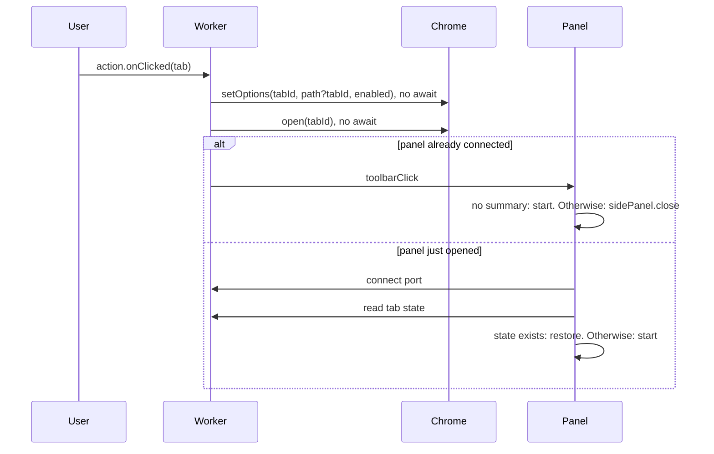

# Sum it up! Design

Inputs: [requirements.md](requirements.md), [mocks/](mocks/index.html).

## Overview

- Chrome extension that summarizes pages, YouTube transcripts, and selected text in a side panel or on-page popup, with chat grounded in that content.
- Manifest V3, minimum Chrome 141. No backend (NFR8): the service worker holds keys and calls the 3 provider APIs directly with the user's key.

## Stack

- WXT 0.21.5, pinned exact. TypeScript. npm.
- React 19, side panel only. Plain CSS with shared variables, styled per Visual Style below. No UI library.
- Plain TypeScript for on-page UI.
- `@mozilla/readability` 0.6.0, loaded on click only.
- Vitest 5, `@playwright/test` 1.64.
- No AI SDK, no Markdown library.

## Components

Paths under `src/`.

| Component | Location | Responsibility |
|---|---|---|
| Service worker | `entrypoints/background.ts` | Toolbar clicks, tab tracking, ports, all provider calls, key access |
| Selection UI | `entrypoints/content/` | Button and popup in a closed Shadow DOM, top frame only, no framework (mocks 05, 06) |
| Side panel | `entrypoints/sidepanel/` | React app, one instance per tab (mocks 01 to 04, 07 to 09) |
| Extractor | `entrypoints/extract.ts` | Unlisted script injected on click. Readability on a cloned document, word count, video flag |
| YouTube reader | `lib/youtube.ts` | Two-step transcript read. All YouTube selectors live here |
| Provider adapters | `lib/providers/{anthropic,openai,gemini}.ts` | One fetch and stream parser per provider |
| Model registry | `lib/models.ts` | Fixed model list, defaults, input limits, per-model request settings |
| Summarizer | `lib/summarize.ts` | Single-call and split-and-merge flows |
| Chat | `lib/chat.ts` | Grounded prompt, part matching, history trimming |
| Prompts | `lib/prompts.ts` | System prompt per level and for chat. Wraps content in delimiters (NFR12) |
| Text tools | `lib/text.ts` | Word count (`Intl.Segmenter`), token estimate, paragraph split, keyword match |
| Output renderer | `entrypoints/sidepanel/Markdown.tsx` | Bullets, headings, bold to React elements. No raw HTML, images, or live links (NFR13) |
| Session store | `lib/session.ts` | Tab state in `storage.session`, eviction |

### Panel UI

| Component | Mock | Notes |
|---|---|---|
| `Header` | 02 | "Sum it up!" wordmark and chevron, then heading ("Page summary" or "Selected text summary"). Fixed (FR73) |
| `LevelSelect` | 03, 04 | "Detail level" label above. Short, Medium, In-depth, ELI5. Fixed (FR73) |
| `ModelMenu` | 04 | "Model" label above. Pill shows model. Holds provider, model, masked key, Delete, notice. All setup lives here (FR4, NFR15) |
| `KeySetup` | 01, 04 | Key field, key page link, notice, Save. Full panel on first use, inside `ModelMenu` otherwise |
| `ScopeLink` | 07 | "Summarize whole page". Fixed |
| `ModelSwitchAction` | 08 | "Summarize with <model>" (FR17). Fixed |
| `ScrollColumn` | 09 | Single scroll area for summary, divider, and messages (FR72). Scrolls to newest message (FR74) |
| `SummaryCard` | 02, 03, 08 | Streaming text, Stop, "Incomplete" tag, Retry, "Video not included" tag |
| `StatusCard` | 08 | Spinner, "New page", long page confirm, all FR46 messages |
| `ChatMessages` | 02, 09 | User and bot bubbles |
| `ChatInput` | all | Fixed at bottom in every state (FR62). Disabled until a summary is on screen (FR71) |

Panel state: `needsKey`, `newPage`, `confirmLong`, `waiting`, `streaming`, `complete`, `incomplete`, `noContent`, `error`. Errors with a summary on screen show as a banner above it (FR47).

### Visual Style

Minimal and modern, per mock 10. `lib/theme.css` holds the variables, used by the panel and the popup.

- Theme: light and dark, follows the system with `prefers-color-scheme`. No theme setting.
- Color: neutral greys, one deep green accent for links, focus, and spinner. Primary buttons use the text color. Amber for "Incomplete" and "Video not included" tags only.

| Variable | Light | Dark |
|---|---|---|
| `--bg` | `#ffffff` | `#18181b` |
| `--text` | `#18181b` | `#f4f4f5` |
| `--muted` | `#71717a` | `#a1a1aa` |
| `--line` | `#e4e4e7` | `#2e2e33` |
| `--soft` | `#f4f4f5` | `#27272a` |
| `--accent` | `#166534` | `#86efac` |

- Wordmark: "Sum it up!" in weight 800 italic, tight letter spacing, accent color, no background, next to the logo. Shown in the panel header and setup. The highlight button uses the same lettering in white with the logo mark, on a `#166534` pill with a full radius. Button text stays regular.
- Logo: exclamation mark made of 3 shrinking white text lines and a `#86efac` dot, on a `#166534` rounded square, inline SVG in the panel, source at `assets/logo.svg`. Toolbar and store icons are PNGs generated from it at 16, 32, 48, and 128px.
- Type: system font stack, no web fonts (NFR10). Body 14px, line height 1.55. Headings 15px, weight 600.
- Layout: no box around the summary. Text sits directly on the panel. 16px panel padding. 1px `--line` divider under the summary whenever one is on screen, scrolling with the content.
- Controls: borderless pills on `--soft`, 8px radius, small label above each dropdown. Chat box 12px radius with a hairline border.
- Chat: user messages in a soft bubble, bot messages as plain text.
- Depth: shadows only on floating elements (dropdowns, popup, highlight button).
- Motion: 120ms fade on dropdowns and popup, a spinner, and streaming text. No other animation. Respects `prefers-reduced-motion`.
- Dropdowns: native `<select>` with `appearance: base-select` (Chrome 135+), so the open list is styled too. `ModelMenu` uses the Popover API.

## Manifest

- Permissions: `sidePanel`, `storage`, `scripting`.
- Host permissions: `<all_urls>`. Needed for FR38 on all sites. Shows Chrome's "read and change all your data" install warning and draws closer store review.
- Content script: `<all_urls>`, `document_idle`, `all_frames: false`.
- Panel disabled by default, enabled per tab with `sidePanel.setOptions({tabId, path, enabled})`.
- No `externally_connectable`. No remote code.

## Data Model

- `storage.local`, restricted with `setAccessLevel(TRUSTED_CONTEXTS)` on install so content scripts have no access:
  - `keys`: `{anthropic?, openai?, gemini?}` strings.
  - `settings`: `{provider, modelByProvider, level}`.
- `storage.session`, memory only, default restricted, cleared on browser restart (FR66):
  - `tab:<tabId>`: `{url, scope, selectionText?, summaries, chat[], source?}`.
  - `summaries`: map of `<url>|<scope>|<level>|<model>` to `{text, status: complete|incomplete}` (FR56).
  - `chat[]`: `{role, text}`.
  - `source`: `{kind: page|transcript|selection, text, videoExcluded}`.
- Limits: 10 MB session quota. Over quota: drop `source` text from the least recently used tab, keep summaries and chat, re-extract on next need at no token cost.
- Cleanup: `tabs.onRemoved` deletes the tab entry (FR56, FR65). Extension update clears session data. Accepted.

## Models

| Provider | Default | Cheap | Most capable |
|---|---|---|---|
| Anthropic | `claude-sonnet-5-5` | `claude-haiku-5-5` | `claude-opus-5-5` |
| OpenAI | `gpt-6.1-sol` | `gpt-6-luna` | `gpt-6-astra` |
| Google | `gemini-3.8-flash` | `gemini-3.5-flash-lite` | `gemini-4-argon` |

- Input limits stored in `lib/models.ts`. Anthropic 1M, OpenAI 1.05M, Google from `inputTokenLimit` at build time.
- Per-model thinking and effort settings stored there, tuned against NFR1. A default that misses NFR1 switches to that provider's cheap model.

## Interfaces

Provider adapter:

- `validateKey(key)` → `void`. Lists models, costs no tokens (FR11). Throws `ProviderError`.
- `stream({key, model, system, messages, maxOutput, signal})` → `AsyncIterable<string>`. Throws `ProviderError`.

| Provider | Stream call | Auth | Validate |
|---|---|---|---|
| Anthropic | `POST api.anthropic.com/v1/messages` | `x-api-key`, `anthropic-version`, `anthropic-dangerous-direct-browser-access: true` | `GET /v1/models` |
| OpenAI | `POST api.openai.com/v1/responses`, reads `response.output_text.delta` | `Authorization: Bearer` | `GET /v1/models` |
| Google | `POST generativelanguage.googleapis.com/v1beta/models/<id>:streamGenerateContent?alt=sse` | `x-goog-api-key` | `GET /v1beta/models` |

`ProviderError.kind`, mapped to FR46:

- `auth`: 401, 403.
- `rate`: 429.
- `unavailable`: 5xx, or no first text within 30s.
- `offline`: fetch `TypeError` with `navigator.onLine` false.
- `cutoff`: stream ended without the provider's finish event.
- `modelGone`: 404 on the model.

Runtime messages:

- Panel to worker: port `panel:<tabId>`. Sends `summarize`, `retry`, `stop`, `chat`, `setLevel`, `setModel`, `saveKey`, `deleteKey`. Receives `state`, `delta`, `done`, `error`, `navigated`, `toolbarClick`.
- Content script to worker: port `selection`. Sends `summarizeSelection {text}`, `stop`. Receives `delta`, `done`, `error`. Message `openPanel {text}` for "More" and no key.
- Worker takes `tabId` from `sender.tab.id`, never from the message. Content script never receives keys.

## Flows

### Toolbar click (FR18 to FR21)

`sidePanel.open` only works in the user action, so the worker calls it before any `await`.

- Open panels hold a port and reconnect when it drops, so a restarted worker sees them again.
- Chevron calls `sidePanel.close`. Other tabs stay disabled (FR23).

### Page summary

- 1. Panel sends `summarize`. Worker checks the key, then the cache by URL, scope, level, model.
- 2. Worker reads content: `scripting.executeScript` runs `extract.ts`, or `lib/youtube.ts` on a watch page. Injection failure or `contentType` PDF means restricted (FR33).
- 3. Under 200 words: `noContent`, no call (FR26). Over the model limit: `confirmLong` with token estimate (FR27).
- 4. Worker streams from the adapter, sends `delta` to the panel, saves text to session as it arrives.
- 5. Stop or port disconnect aborts the fetch. Text so far saved as `incomplete` (FR32, FR77). No auto-retry anywhere (FR48).

### Long content (FR27, FR28)

- Estimate: characters / 2.5, the conservative ratio from Anthropic's docs. Used for all providers.
- Split on paragraph boundaries, each part at most 80% of the input limit.
- Summarize parts, 3 at a time, without streaming. Panel shows "Summarizing" (spinner).
- Merge part summaries in one final streamed call at the selected level.
- Any part failing fails the whole run, with the matching FR46 message.

### Chat (FR63, FR64, FR78)

- System prompt: answer only from delimited content, otherwise reply exactly "This page doesn't cover that".
- Under the limit: send full `source.text` each question.
- Over the limit: split into parts, score with keyword match, send top parts up to the limit. No match: return the fixed reply with no API call.
- History trimmed oldest first to stay under the limit. Cleared on URL change and on scope change (FR45, FR58).

### Selection (FR38 to FR44)

- `mouseup` handler counts words only when a selection exists. Skips inputs and `isContentEditable` (FR40).
- Button click must have `event.isTrusted`, so a page script cannot trigger a paid call (NFR11).
- Popup renders with `textContent`, fixed position above the selection, below it when there is no room.
- "More" and no key: `openPanel` message, worker calls `setOptions` and `open` synchronously in the handler, panel starts with scope `selection`.

### Navigation (FR57 to FR61)

- `tabs.onUpdated` with `url`: compare with stored URL minus fragment. Different: clear summary and chat view, send `navigated` (mock 08). Fragment only: ignore.
- `status: loading` with the same URL: reload, delete that URL's summaries (FR57).
- Works for single-page apps, since `onUpdated` reports history changes.

### YouTube transcript (FR34, FR35, new FR46 row)

- 1. Watch page detected by URL. Worker runs a `MAIN` world script: read caption tracks from the player's response data, checking the video ID matches the URL, since `ytInitialPlayerResponse` goes stale after in-page navigation.
- 2. Empty track list: "No transcript available for this video".
- 3. Tracks exist: fetch the track URL from the page, parse `json3`.
- 4. Empty response: click "Show transcript", wait up to 5s for segments, read text, close the panel.
- 5. Both fail: "Couldn't read the transcript", Retry.

## Infra

- Repo: GitHub. No hosting, no server.
- `.github/workflows/ci.yml`, on pull request: `tsc`, Vitest, `wxt build`, Playwright against a local fake provider server. No keys, no tokens.
- `.github/workflows/release.yml`, on version tag: runs CI steps, `wxt zip`, attaches the zip to a GitHub Release. Upload to the store is manual.
- `npm run eval`, local with your keys, before each release: NFR1, NFR4, NFR5 report, NFR10 network log, NFR12, FR64, FR76, and 5 live YouTube videos. Test pages in `evals/pages.json`.
- Test build sets provider base URLs through a build variable to reach the fake server. Production builds hardcode real hosts.
- Playwright: `launchPersistentContext` with `--load-extension`. Fake server scripts every FR46 failure.
- Store listing: privacy disclosure (NFR14) and privacy policy in `store/`.

## Key Decisions

- D1. All provider calls in the service worker. Alternative: panel calls for panel features. Why: popup also needs calls, and content scripts run on untrusted pages, so one keyed location is safest.
- D2. WXT pinned exact. Alternative: plain Vite. Why: saves manifest, reload, and packaging work, and only runs at build time. Risk: one main maintainer, pre-1.0.
- D3. Direct fetch adapters. Alternative: Vercel AI SDK. Why: auditable network calls (NFR10), raw status codes (FR46), no retry defaults to disable (FR48).
- D4. React in panel, plain TypeScript on pages. Alternative: React everywhere. Why: protects the 50ms limit in NFR3 on every site.
- D5. Plain CSS with a defined visual style, no UI library. Alternative: Tailwind or a component kit. Why: about a dozen components, the look comes from the variables and rules above, and native dropdowns plus the Popover API cover what a kit would add.
- D6. Readability injected on click. Alternative: bundle in the content script. Why: nothing heavy loads on page load.
- D7. Two-step YouTube read. Alternative: caption fetch only, or a paid API. Why: survives one method breaking, and paid APIs break NFR8.
- D8. Keyword match for long-page chat. Alternative: part summaries, embeddings. Why: uses real page text at no extra API cost. Limit: misses questions that share no words with the page.
- D9. Key check by listing models. Alternative: 1-token test call. Why: no token cost.
- D10. Abort on panel close (FR77). Alternative: keep generating. Why: no spending with nothing on screen, and the worker can be shut down mid-run.
- D11. Summaries streamed through `storage.session`. Alternative: IndexedDB. Why: memory only, so FR66 holds without extra cleanup.
- D12. Manual store upload. Alternative: automated on tag. Why: no store credentials in CI, and a bad tag cannot reach review.

## Open Questions

Build checks, not product decisions. First build task proves each one in real Chrome.

- OQ1. `sidePanel.open` from a content script message (FR42, FR44). User action passing through messaging is unconfirmed. If it fails, "More" and no-key flows need a requirement change. Owner: implementer.
- OQ2. YouTube read steps on current YouTube, including how often the fallback runs. Owner: implementer.
- OQ3. Direct calls from the worker for all 3 providers, including the Anthropic header (community sources only), OpenAI `GET /v1/models`, and Gemini streaming with `x-goog-api-key`. Docs fetched for this design did not state these. Owner: implementer.
- OQ4. NFR1 on the 3 default models. Owner: implementer.
